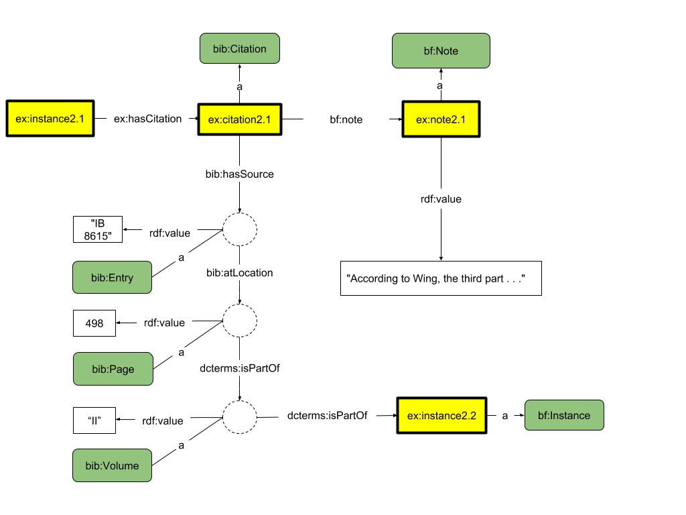
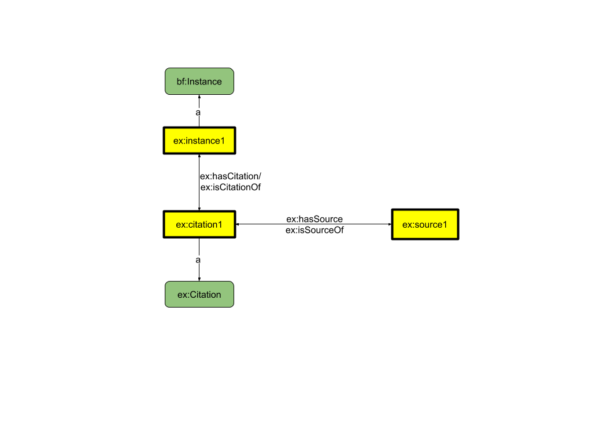
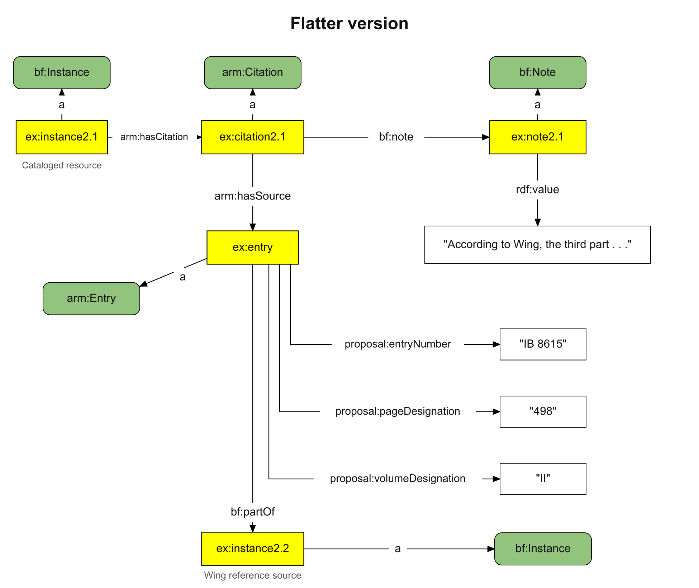

# ARM bibliographic citation modeling

Here I’m looking at the existing bibliographic citation model and trying to lay out the intended modeling patterns. This was prompted by the lack of detailed examples in the v1.0 Implementation Guidelines, with additional examples buried in the v0.1 modeling recommendations and using outdated terms. I try to describe the modeling and raise some potential questions/issues with the current model as I understand it.

I also briefly explore a flatter and possibly simpler model that attempts to address some of the issues I raise. Regardless of which model we decide on, it's important that the Implementation Guidelines be revised to make it clearer how to structure bibliographic citations in ARM.

The diagrams and [Turtle examples](examples/) are included in this folder.

Please post questions, comments, responses, etc. on [this issue](https://github.com/Art-and-Rare-Materials-BF-Ext/arm/issues/82)

## Use cases

The [v1.0 Implementation Guidelines](https://github.com/Art-and-Rare-Materials-BF-Ext/arm/blob/main/v1.0/implementation_gudelines.pdf) describe four use cases (pages 8-9):

1. A citation is found, and the cataloger does not add commentary on the citation.

2. A citation is found, and the cataloger adds commentary on the citation.

3. A citation is not found, and the cataloger does not add commentary.

4. A citation is not found, and the cataloger adds further commentary about the reference source or a related citation.

Each use case needs an identified reference source and a way to indicate status (found or not found). It seems implied that a “found” citation would also need a location within the source, however, this isn’t always true in cataloging and in fact one of the examples omits this. A way to add cataloger commentary is also needed for cases 2 and 4.

## Classes and properties involved

Taken from the v1.0 Implementation Guidelines and extrapolating from the v0.1 [Bibliographic Citations for Rare Materials Cataloging](https://github.com/Art-and-Rare-Materials-BF-Ext/arm/blob/main/v0.1/modeling_recommendations/bibliographic_citations.md) modeling recommendations.

### Classes

- arm:Citation

- arm:Entry

- arm:Page

- arm:Volume

- bf:Note

### Properties

- arm:hasCitation

- arm:hasSource

- arm:atLocation (or bf:place? These have been used interchangeably depending on the specific example or documentation)

- dcterms:isPartOf (or bf:partOf? These have been used interchangeably depending on the specific example or documentation)

- bf:note

## Existing detailed pattern

ARM v.0.1 provided several diagrams as part of their modeling recommendations. I’m extrapolating to assume that these modeling patterns carried through to v1.0, albeit using v1.0’s classes and properties instead. When looking at the diagram below, ignore the specific class and property names and focus on the intentions behind them and how they contribute to the overall modeling pattern.

This example is taken directly from the v0.1 modeling recommendations:

Key: Yellow rectangle = named resource, dashed circle = blank node, green rounded boxed = class, white box = literal value

I also mocked up a [Turtle representation of this diagram.](examples/wing_citation_existing_detailed.ttl)

This example illustrates use case 2: "Citation located, cataloger adds commentary on citation." It shows entry "IB 8615", on page 498 of volume II of Wing. The cataloged resource is ex:instance2.1, and the Wing reference source is ex:instance2.2, typed as bf:Instance. The citation also carries a cataloger note: "According to Wing, the third part . . ."

Note how this existing pattern models the entry through separate Page and Volume entities before reaching the source Instance.

### Questions

- Do we think separate Page and Volume entities are necessary or desirable?

- Is there a need/desire to attach separate info to each of these entities?

- Are "Page" and "Volume" too generic, either in terms of labels or the classes themselves? If kept in the ontology, would we want to rename them?

- Is the chain of Entry → Page → Volume → Reference source too complex and hierarchical?

## Existing basic pattern

The v0.1 modeling recommendations also give an example of a simpler, basic citation:

[Here is a Turtle representation of this diagram.](examples/citation_basic.ttl)

In this situation, the citation links directly to the reference source instead of linking to it via intermediaries like Entry, Page, and/or Volume. This is explicitly supported in the v1.0 Implementation Guidelines (page 9): "A citation may link directly to its source, or it may link indirectly to the source through a specific location via arm:Entry, arm:Page and arm:Volume." (Note also that this includes inverse properties, but that is an issue for another time)

### Questions

- Do we want to retain the flexibility of allowing the citation to link either directly to a reference source (most likely a bf:Instance) or to an arm:Entry?

- Or does this expand the range of arm:hasSource (or whichever property we end up using for this purpose) too much?

- Would this complicate querying?

## Flatter, possibly simpler, pattern

Here is a “flatter” version of the above detailed citation:

[Here is a Turtle representation of this diagram.](examples/wing_citation_flatter.ttl)

The flatter version retains the Entry and links it directly to the source Instance, with entry number, page, and volume recorded as values of properties. Both retain the Citation and its cataloger note. The “proposal” property names are placeholders that could represent newly-created ARM properties or properties taken from an external ontology.

### Questions

- Does this pattern actually seem simpler than the existing pattern? Why or why not?

- Does the grouping of properties and values in this model make sense? Is there a need for more granularity, or more hierarchy?

- Are there properties we could reuse from other ontologies? (Note: [BIBO](https://dcmi.github.io/bibo/) looks promising, and it's maintained by DCMI) Or would we want to define our own properties for this purpose?

## "Found"/"not found" status

Note that there is no indication of “found” or “not found” status in these diagrams/examples. ARM v0.1 modeled negative citations as bf:Note, with the value "not found," but did not mention positive “found” citations. ARM v1.0 added “found” and “not found” values to its existing [status vocabulary](https://github.com/Art-and-Rare-Materials-BF-Ext/arm/blob/main/v1.0/vocabularies/status.rdf), and extrapolating from the other values of that vocabulary and their usage, I assume they were intended to be used with bf:status. But I haven’t found any examples or guidance explicitly saying this, so I decided not to include it for now.

## Pros, cons, and general questions

Both models structure citations in mostly the same way. However, the existing pattern represents pages and volumes as separate resources connected by relationships, while the flatter pattern records them as values on the Entry.

| Approach | Pros | Cons |
| --- | --- | --- |
| Retain the existing pattern | With separate Entry, Page and Volume entities, could potentially record info for each entity individually (e.g., scans/transcriptions) | More hierarchically structured with more intermediate resources; more potential citation "paths" that queries would have to accommodate; “Page” and “Volume” may need to be redefined to be more specific, and/or we might need to consider classes from an external ontology |
| Flatten while retaining Entry class | Less hierarchical and possibly easier to query; potential for reuse of properties instead of creating “generic” classes | Cannot separately describe Page or Volume entities, only the Entry; would have to find/define suitable properties; loses the explicit hierarchy of an entry as part of a page as part of a volume as part of a reference source |

(Note that some of these are not "cons" per se, but things that would require additional work vs. the alternative)

### General questions/considerations

- Can you think of more pros and cons for each approach? Or additional approaches I’m not thinking of?

- If we retain the existing pattern, we will need to ensure that the properties involved are still necessary and defined appropriately if so, or whether they can be deprecated in favor of BIBFRAME properties. As it stands, some of these properties are defined rather generically and overlap considerably with BIBFRAME, but the BIBFRAME property might not quite align with ARM's bibliographic citation usage.

See [arm_scopenotes_review.xlsx](https://docs.google.com/spreadsheets/d/1MRpr7caVF1su2Mpc-cTNJcToUBRPkYuP/edit?usp=sharing&ouid=106041580234260263718&rtpof=true&sd=true) for the Rare Book Subteam's discussion of these properties, among others.

## Resources consulted

[https://github.com/Art-and-Rare-Materials-BF-Ext/arm/blob/main/v1.0/implementation_gudelines.pdf](https://github.com/Art-and-Rare-Materials-BF-Ext/arm/blob/main/v1.0/implementation_gudelines.pdf)

[https://github.com/Art-and-Rare-Materials-BF-Ext/arm/blob/main/v0.1/modeling_recommendations/bibliographic_citations.md](https://github.com/Art-and-Rare-Materials-BF-Ext/arm/blob/main/v0.1/modeling_recommendations/bibliographic_citations.md)

[https://github.com/Art-and-Rare-Materials-BF-Ext/arm/blob/main/v1.0/vocabularies/status.rdf](https://github.com/Art-and-Rare-Materials-BF-Ext/arm/blob/main/v1.0/vocabularies/status.rdf)

## Please post questions, comments, responses, etc. on [this issue](https://github.com/Art-and-Rare-Materials-BF-Ext/arm/issues/82)
